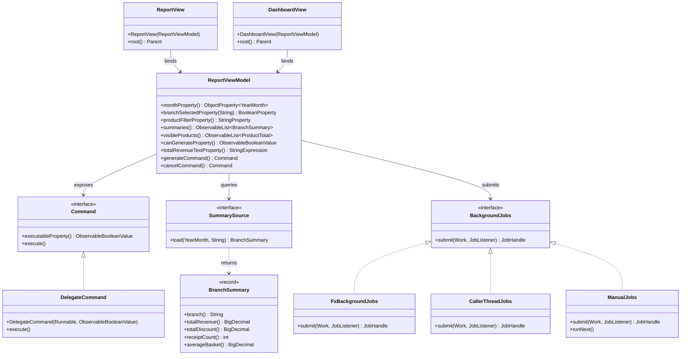
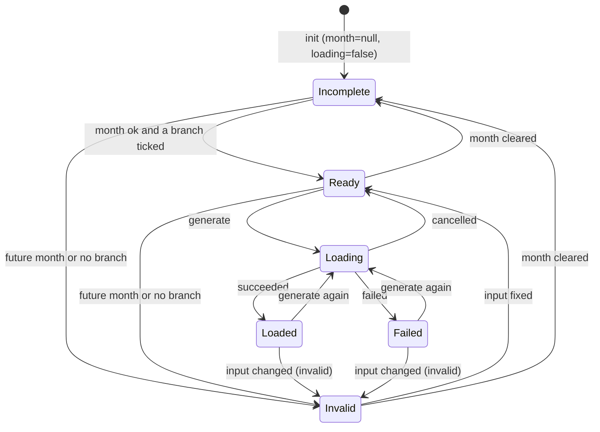

# ViewModel Design — Angkor Mart Monthly Sales Report (MVVM)

## 1. Lab-02 Controller Inventory & Ownership Migration

| Code (Lab-02 MVC) | Concern | New Owner |
| :--- | :--- | :--- |
| `monthField.getText()` / `monthField.setOnAction(...)` | Month input state and change reaction | **View** (two-way bound to `ViewModel.monthProperty()`) |
| `branchBox.getValue()` / `branchBox.setOnAction(...)` | Selected branch state | **View** (two-way bound to `ViewModel.branchSelectedProperty(b)`) |
| `InputRules.month(text, clock)` | Month required & future-date validation | **ViewModel** (`monthErrorProperty`) |
| `InputRules.branch(text)` | At least one branch selected rule | **ViewModel** (`branchErrorProperty`) |
| `if (result instanceof Invalid)` -> `errors.showError(...)` | Formatting and exposing validation/load errors | **ViewModel** (`validationMessageProperty`, `loadErrorProperty`) |
| `if (command instanceof LoadMonth)` -> `model.load(...)` | Orchestrating month loading across branches | **ViewModel** (`generateCommand` -> `BackgroundJobs` -> `SummarySource`) |
| `errors.clearError()` | Clearing previous error banner on new run | **ViewModel** (resets `loadError` at start of `generate()`) |
| `catch (NoSuchFileException / IOException)` | Retaining previous data on failure and exposing message | **ViewModel** (`JobListener.failed(error)`) |
| `table.getItems().setAll(...)` / `chart.getData()...` | Rendering branch summaries and top products | **View** (bound to `summaries()` and `visibleProducts()`) |
| `status.setText(...)` | Updating status text across lifecycle states | **ViewModel** (`statusProperty` one-way bound to `Label`) |

---

## 2. `ReportViewModel` Members

### Input State (Two-way bound — View may read and write)
| Member | Type | View Writable? | Purpose |
| :--- | :--- | :--- | :--- |
| `monthProperty()` | `ObjectProperty<YearMonth>` | Yes | Selected or typed report month |
| `branchSelectedProperty(String)` | `BooleanProperty` | Yes | Per-branch inclusion tick (`PNH`, `REP`, `BTB`) |
| `productFilterProperty()` | `StringProperty` | Yes | Case-insensitive filter text for top products |

### Output State (One-way bound — View may read only)
| Member | Type | View Writable? | Purpose |
| :--- | :--- | :--- | :--- |
| `monthChoices()` | `ObservableList<YearMonth>` (unmodifiable) | No | Last 12 months from `YearMonth.now(clock)` |
| `summaries()` | `ObservableList<BranchSummary>` (unmodifiable) | No | Loaded branch summaries for table |
| `visibleProducts()` | `ObservableList<ProductTotal>` (`FilteredList`) | No | Top products filtered by `productFilter` |
| `loadingProperty()` | `ReadOnlyBooleanProperty` | No | `true` while background job runs |
| `progressProperty()` | `ReadOnlyDoubleProperty` | No | Fractional progress (`0.0` to `1.0`) |
| `statusProperty()` | `ReadOnlyStringProperty` | No | Human-readable lifecycle status |
| `loadErrorProperty()` | `ReadOnlyStringProperty` | No | Last load failure message |

### Computed State (Derived bindings — View may read only)
| Member | Type | View Writable? | Purpose |
| :--- | :--- | :--- | :--- |
| `monthErrorProperty()` | `StringExpression` | No | `"Choose a month."` or `"Month <m> is in the future."` |
| `branchErrorProperty()` | `StringExpression` | No | `"Select at least one branch."` if all unticked |
| `validationMessageProperty()` | `StringExpression` | No | Non-empty `monthError` and `branchError` joined by `" "` |
| `canGenerateProperty()` | `ObservableBooleanValue` | No | `valid && !loading` |
| `totalRevenueProperty()` | `ObservableObjectValue<BigDecimal>` | No | Sum of `summaries` revenues |
| `totalRevenueTextProperty()` | `StringExpression` | No | Formatted `"USD 12,345.60"` |

### Commands
| Member | Type | View Writable? | Purpose |
| :--- | :--- | :--- | :--- |
| `generateCommand()` | `Command` | No (executes only) | Triggers async branch load when `canGenerate` is true |
| `cancelCommand()` | `Command` | No (executes only) | Cancels running job when `loading` is true |

---

## 3. Class Diagram

---

## 4. Screen State Machine

### Property Values per State
| State | `loading` | `canGenerate` | `validationMessage` | `loadError` | `status` |
| :--- | :--- | :--- | :--- | :--- | :--- |
| **Incomplete** | `false` | `false` | `"Choose a month."` | `""` | `"Choose a month."` |
| **Invalid** | `false` | `false` | `"Month 2026-10 is in the future."` / `"Select at least one branch."` | `""` | *(unchanged)* |
| **Ready** | `false` | `true` | `""` | `""` | *(unchanged or `"Cancelled, previous data kept."`)* |
| **Loading** | `true` | `false` | `""` | `""` | `"Loading N branch(es) for yyyy-MM..."` |
| **Loaded** | `false` | `true` | `""` | `""` | `"Loaded N branch(es) for yyyy-MM."` |
| **Failed** | `false` | `true` | `""` | `"<exception message>"` | `"Load failed, previous data kept."` |
